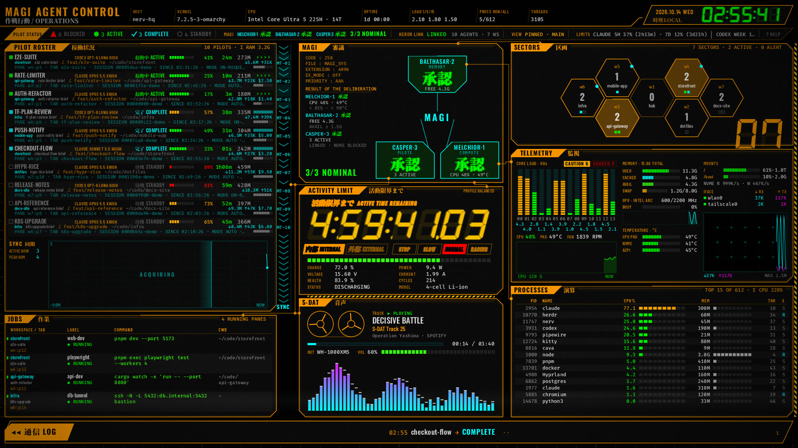
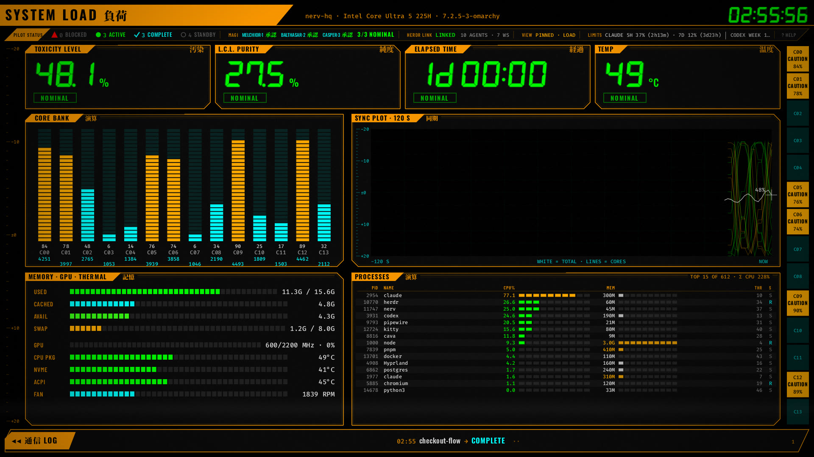
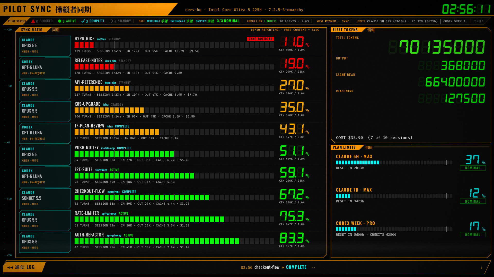
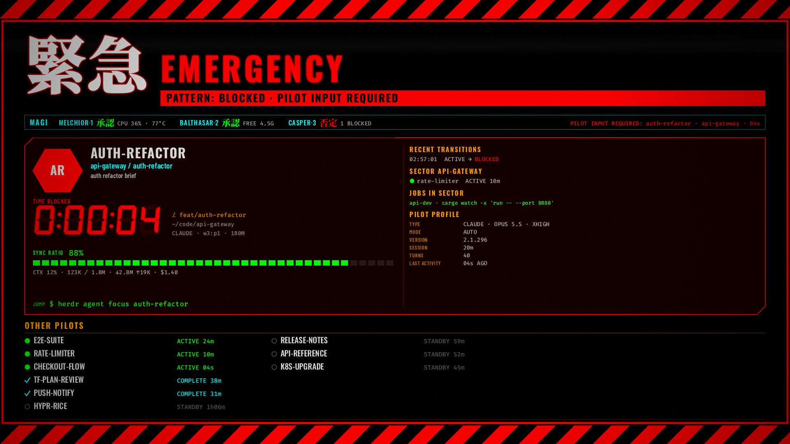

# NERV MAGI

**An Evangelion-style command board for your AI coding agents.** Every Claude Code and Codex agent
running in [herdr](https://herdr.dev) (model, context, tokens, cost, who is blocked), plus btop-grade
system telemetry, power and now playing. It runs as a GPU-native full-screen dashboard you can put on
the TV, a terminal board inside herdr, and an Omarchy bar widget.

No web view, no server, no Electron: one Rust binary drawing with OpenGL (femtovg) at about 3 % of
one core at 4K.



| LOAD | SYNC | EMERGENCY |
|---|---|---|
|  |  |  |

*All screenshots run on the built-in demo data (`nerv tv --demo`): made-up projects and agents.*

## What it shows

- **Pilot roster.** Every herdr agent: Claude or Codex, model, effort, mode, status
  (ACTIVE / BLOCKED / COMPLETE / STANDBY), time in state, branch, cwd, context used, tokens in/out
  and cache, turns and cost. Usage comes from the agents' own session logs.
- **MAGI.** Three verdicts, the way the MAGI vote: MELCHIOR·1 on CPU load and temperature,
  BALTHASAR·2 on free memory, CASPER·3 on the pilots (no blocked agent). 承認 / 否定.
- **SYNC ratio.** Context usage per agent as a sync ratio, fleet token totals, and plan limits
  (Claude 5 h / 7 d, Codex week, with resets).
- **Telemetry.** Per-core load and frequency, GPU, temperatures and fan, memory and swap, mounts,
  disk and network rates, the top processes, and the jobs running in herdr panes.
- **Activity limit.** The battery as the Eva 活動限界 countdown (internal / external, charge,
  health, cycles, watts).
- **S-DAT.** Now playing (MPRIS), output device and volume, and a live spectrum (cava).
- **EMERGENCY.** When an agent is blocked on a question or approval, or memory runs critically low,
  the dashboard takes over with the pilot card and the command to jump to it
  (`herdr agent focus <name>`).

Views rotate MAIN → LOAD → SYNC, a BOOT sequence plays at start, and EMERGENCY overrides
everything (even a pinned view). It adds scanlines (off · subtle · heavy · crt), film grain, a
vignette and CRT roll.

## Install

Needs Linux with Wayland (built on Omarchy / Hyprland), Rust, `jq`, and for the data: herdr ≥ 0.9,
`playerctl` (now playing), `pipewire`/`wpctl` (volume) and `cava` (spectrum). Each piece degrades
to OFFLINE when its tool is missing.

### As an Omarchy plugin (bar widget)

```bash
omarchy plugin add https://github.com/anomius/nerv-magi.git --enable
~/.config/omarchy/plugins/anomius.nerv-magi/scripts/install.sh   # builds nerv → ~/.local/bin
```

The widget is a hexagon: dim when no agent works, lit with the active-agent count, **red and
pulsing while any agent is blocked**. Left click opens the panel (pilot roster, *Open here*,
*Cast to TV*, *Hub*, view switcher, scanlines, grain), middle click goes to the next view, right
click opens or closes the dashboard. Clicking a pilot focuses it in herdr.

Everything is also scriptable for keybindings:

```bash
omarchy-shell anomius.nerv-magi window          # open the dashboard here
omarchy-shell anomius.nerv-magi cast            # cast it to the TV (see below)
omarchy-shell anomius.nerv-magi stop
omarchy-shell anomius.nerv-magi view sync       # main | load | sync | emergency | auto | next | …
omarchy-shell anomius.nerv-magi status
```

After `omarchy plugin update anomius.nerv-magi`, re-run `scripts/install.sh` and
`omarchy restart shell` (a hot-reloaded widget keeps answering IPC from its old copy until then).

### As a herdr plugin

```bash
herdr plugin install anomius/nerv-magi      # or, from a clone:  herdr plugin link /path/to/nerv-magi
```

That adds the **hub** pane (the terminal board) and actions: `open-hub`, `tv-start`, `tv-stop`,
`tv-cast`, `tv-uncast`, `tv-view-next`, `tv-view-auto`, `tv-pin`, `tv-fullscreen`,
`tv-scanlines`, `tv-grain`.

### From source

```bash
git clone https://github.com/anomius/nerv-magi.git && cd nerv-magi
scripts/install.sh            # cargo build --release, installs ~/.local/bin/nerv
nerv tv --demo --windowed     # try it with made-up data
nerv tv                       # the real thing (fullscreen)
nerv hub                      # terminal board
nerv dump                     # the whole state as JSON
```

## The TV window

Keys: `1`–`4` MAIN · LOAD · SYNC · EMERGENCY (pins the view) · `Tab` `→` `←` next / previous ·
`Space` `p` pin / unpin · `0` `a` automatic rotation · `f` `F11` fullscreen · `s` scanlines ·
`g` grain · `?` `h` help · `q` `Esc` quit. The pointer hides after 3 s in fullscreen.

From anywhere: `scripts/tv-ctl.sh <main|load|sync|emergency|next|prev|auto|pin|fullscreen|scanlines|grain|help>`.

Headless: `nerv tv --demo --scene main --size 3840x2160 --frames 900 --snapshot main.png`
renders a frame without a window (`--bench 30` measures CPU and RSS instead).

## Put it on the TV

**AirPlay (Omarchy).** With [omarchy-cast](https://github.com/jonspinks/omarchy-cast) installed and a
TV paired, *Cast to TV* (or `scripts/tv-cast.sh`) starts a second desktop on the TV, opens the
dashboard fullscreen there without taking your focus, and closes it when the TV goes away.
`[tv] cast_audio = true` sends the system sound along. Most AirPlay TVs mirror at 1920×1080; the
layout is designed for it.

- Some TVs (seen on a TCL Google TV) stop advertising AirPlay for a few minutes after a session
  ends: start the cast once and leave it running. The script retries a refused start, and toggling
  AirPlay in the TV's settings brings it back at once.
- **4K:** use an HDMI cable. The dashboard renders natively at 3840×2160.

**Anything else.** `nerv tv` is a normal Wayland window (app id `nerv-tv`): put it on any output
with a window rule, e.g. Hyprland `o.window("^nerv-tv$", { no_initial_focus = true })` plus a
workspace rule, or set `[tv] workspace`.

## Configuration

`~/.config/nerv/config.toml` (or herdr's plugin config dir, `herdr plugin config-dir nerv.magi`).
Every key is optional:

```toml
[tv]
workspace = "7"                # where a fullscreen tv-start goes, e.g. the TV's output (default: current)
cast_receiver = "192.0.2.7"    # AirPlay receiver for tv-cast (default: first paired)
cast_audio = false
start_fullscreen = true
scanline_style = "subtle"      # off | subtle | heavy | crt
scanline_roll = true
crt_flicker = false
vignette = true
grain = true
grain_strength = 0.35
cursor = "auto"                # auto | always | never
cursor_hide_secs = 3
rotate = true
main_secs = 45
load_secs = 15
sync_secs = 15
boot_secs = 4
emergency_overrides_pin = true
emergency_hold_secs = 5
fps_active = 60
fps_calm = 10

[thresholds]                   # the MAGI votes
cpu_max = 0.85
cpu_temp_max_c = 90.0
mem_min_available_bytes = 1500000000
mem_critical_bytes = 800000000 # below this: EMERGENCY

[fonts]                        # optional overrides (absolute paths)
mincho = "/path/to/a/licensed/MatisseEB.otf"
```

## Live context for Claude (optional)

Context and plan limits are read from the agents' session logs. For live numbers on Claude Code,
let your statusline script also drop the JSON it receives into nerv's cache. Add this after it
reads its input (`input=$(cat)`):

```bash
{ _nd="$XDG_RUNTIME_DIR/nerv/claude-status"; _sid=$(printf '%s' "$input" | jq -r '.session_id // empty');
  [ -n "$XDG_RUNTIME_DIR" ] && [ -n "$_sid" ] && mkdir -p "$_nd" && printf '%s' "$input" > "$_nd/.$_sid.tmp" && mv -f "$_nd/.$_sid.tmp" "$_nd/$_sid.json"; } 2>/dev/null
```

## Privacy

Everything stays on your machine. nerv reads `/proc` and `/sys`, herdr's socket (read-only:
`session.snapshot`, `agent.list`, `pane.process_info`, `events.subscribe`), the agents' session logs
under `~/.claude` and `~/.codex` (read-only), and `playerctl` / `wpctl` / `cava` output. It never
writes to herdr, to the agents or to their logs, and it makes no network requests.

## Credits

- Fonts (SIL Open Font License 1.1, bundled in `assets/fonts` with their licenses, fetched by
  `scripts/fetch-fonts.sh` from their git repos): Oswald, Barlow Condensed, Fira Code and
  Noto Serif JP (subset) from [google/fonts](https://github.com/google/fonts), and DSEG7 from
  [keshikan/DSEG](https://github.com/keshikan/DSEG).
- [herdr](https://herdr.dev), [Omarchy](https://omarchy.org),
  [omarchy-cast](https://github.com/jonspinks/omarchy-cast), [femtovg](https://github.com/femtovg/femtovg),
  [ratatui](https://ratatui.rs).
- Visual language inspired by *Neon Genesis Evangelion*. This is a fan homage: not affiliated with
  or endorsed by khara, Inc. or Gainax, and it contains no material from the series.

## License

MIT, see [LICENSE](LICENSE). The bundled fonts keep their own OFL-1.1 licenses.
